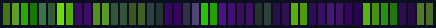
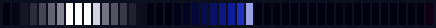
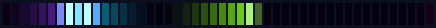

# House Lights

A web dashboard for permanent outdoor lights (roofline and eave lights), run on a computer in
your home. It is tested on **Govee H806A** controllers. Open-source **WLED** controllers,
**JellyFish**, and lights on the Smart Life / Tuya platform (**ASAHOM**, **TreatLife**, likely
**Astoria** and many other brands) are supported but not yet tested on real hardware (see
[Supported controllers](#supported-controllers)). Play animated themes light by light, apply
static themes, schedule them by clock time or sunrise/sunset, and make your own themes. It talks
to the light controllers directly over your home network: no cloud service and no app login while
it runs (Tuya / Smart Life lights need a one-time key lookup, see
[Getting each kind of controller ready](#getting-each-kind-of-controller-ready)). Free for
personal and other noncommercial use (see [License](#license)).

Run it on a computer you already have (**Windows**, **Mac** or Linux) or on a
**Raspberry Pi 3 or newer**, on the same home network as the lights. Leave it running for
schedules to work; any phone or computer on that network can open the dashboard.

## A theme for every holiday and every night

**106 built-in themes** for every occasion: Christmas, Thanksgiving, Halloween, the 4th of July,
Diwali and the other Hindu festivals, birthdays, school spirit, everyday looks and more.
**82 are animated light by light**: every light gets its own color, 15 times a second, so a
comet can race the whole roofline, snow can streak past the windows and fireworks can go off
over the garage. Pick one in two taps, or schedule it from sunset to bedtime.

> ### [**See all 106 themes, moving →**](docs/themes.md)
> Every theme drawn as a strip of lights, animated, by holiday. Pictures are made by the same
> code that plays them on your house.

**Make your own.** Nothing is locked. In the dashboard's **Themes** tab, open any built-in
theme, change its colors, speed and size, and save it as yours, or build one from scratch from
movements (chase, twinkle, fireworks, drift, flicker and more), up to three layers, a shape
(direction, mirror, whole house) and sequences of themes that fade into each other. Take
colors from a palette, from one color or from a photo. Your themes work everywhere a built-in
one does (Quick Settings, schedules) and can be exported as a file to share. [How it works.](#themes)

**In season now:**

- **Christmas** (19 themes): reindeer dash, blizzard, northern lights, peppermint twist,
  jingle beat.
- **Thanksgiving** (12 themes): leaf storms, harvest fireworks, a turkey trot, a cozy
  fireplace.
- **Animated-fast** (28 themes): for the nights you want to stand out. Racing comets, marquee
  bulbs, color wipes, dance beats, fireworks finales. Most are also in their holiday's group.

| Theme | On 48 lights |
|---|---|
| **Reindeer dash** (Christmas) |  |
| **Leaf storm** (Thanksgiving) |  |
| **Witch's brew** (Halloween) |  |
| **Rangoli chase** (Diwali) |  |
| **Patriot racers** (USA) |  |
| **Neon racers** (Animated-fast) |  |

Light-by-light animation works on **Govee H806A** (tested on real lights) and **WLED** (so far
tested only with a simulator); see
[Supported controllers](#supported-controllers) for what each kind can do.
[Full theme gallery](docs/themes.md).

## What's in it

- 106 built-in themes: **Animated-fast**, Christmas, Thanksgiving, USA, celebrations and
  birthdays, other US holidays, Halloween, school spirit, Diwali and Hindu festivals, India,
  everyday looks. [See them all.](docs/themes.md)
- Quick Settings with theme tiles, **Your house** (one row per run, drawn to scale), a panel
  per run, a Themes tab to change a theme or make your own, and Schedules. A light and a dark page; works on a
  phone.
- A setup wizard on first start: it finds your controllers, blinks each one so you can name
  it, helps you count the lights, and saves your settings.

## Supported controllers

| Controller | What works | Tested with real hardware? |
|---|---|---|
| **Govee H806A** | Everything: animated themes light by light, static themes, colours, schedules | **Yes** |
| **Govee permanent outdoor lights** (other models, see below) | Basic control; animated themes light by light to try | Not yet |
| **Any other Govee light with LAN Control** | One colour at a time: colours, warm white, on/off, brightness, schedules. Themes show their main colour | Not yet |
| **WLED**: the open-source controller firmware (ESP8266/ESP32), also on some brand-name kits | Everything: animated themes light by light, static themes, colours, schedules | Not yet: tested against a simulator built from the WLED documentation |
| **JellyFish Lighting** | Static themes (up to 30 colours per pattern: exact for banded themes, rounded otherwise), colours, on/off, brightness, schedules. Animated themes show as a still picture | Not yet: simulator built from JellyFish's API documentation |
| **Tuya / Smart Life**: the app platform behind many Amazon brands, e.g. most ASAHOM kits | One colour at a time: colours, warm white, on/off, brightness, schedules. Themes show their main colour | Not yet: tested with a stand-in for the tinytuya library |

If you try one of the untested kinds, please report what works and what doesn't.

### Govee models

House Lights talks to Govee lights over your home network with Govee's LAN API: switch on
**LAN Control** for each device in the Govee Home app. Govee documents only the basic LAN
commands (on/off, brightness, colour, status). Colouring segments and streaming every light
use two further Govee commands that are checked on the H806A only, so other models get them
step by step:

| Models | Product (as sold) | In House Lights |
|---|---|---|
| H806A | Govee permanent outdoor lights (product name to be confirmed) | Everything; tested on real controllers |
| H705A, H705B, H705C | Permanent Outdoor Lights | Basic control; light-by-light animation to try |
| H705D, H705E, H705F | Permanent Outdoor Lights 2 | Basic control; light-by-light animation to try |
| H706A, H706B, H706C | Permanent Outdoor Lights Pro | Basic control; light-by-light animation to try |
| H805A, H805B, H805C | Permanent Outdoor Lights Elite | Basic control; light-by-light animation to try |
| H707A, H707B, H707C | Permanent Outdoor Lights Prism | Basic control; light-by-light animation to try |
| H3A51, H3A52, H3A53 | Permanent Outdoor Lights 2 Pro | Basic control (LAN Control not confirmed); light-by-light animation to try |
| Any other Govee model with LAN Control (floodlights, spotlights, path, string and wall lights) | | One colour at a time |

"To try": the wizard's last counting test (light 1 red, the last light blue) shows at once
whether your model plays light by light. If it does, please report the model so it can be marked as tested.
Model numbers and names come from Govee's site and community lists; check your box or the
Govee Home app for yours.

### Which one is my brand?

Look at the app your lights use:

| Your lights use | Brands (examples) | Pick in the wizard |
|---|---|---|
| **Govee Home** app | Govee | Govee |
| **Smart Life** or **Tuya Smart** app | Most **ASAHOM** kits, **TreatLife**, and many other (often unbranded) Amazon permanent-light kits | Tuya / Smart Life |
| A brand app that links to Google Home or Alexa **through Smart Life** | **Astoria** (its own Astoria Lighting app, built on the Smart Life / Tuya platform as far as we can tell) | Tuya / Smart Life (likely; not tried yet, see below) |
| **WLED** app, or a WLED page when you open the controller's address in a browser | DIY and open-source controllers, controllers sold "with WLED", **ASAHOM Pro** models sold as having WLED. Some owners of other brands swap in a WLED controller | WLED |
| **JellyFish** app | JellyFish Lighting | JellyFish |

The app is the clue, not the brand: many brands rebuild the Smart Life app under their own
name. If your box or manual says "Smart Life" or "Tuya", or the brand's Alexa / Google Home
setup goes through Smart Life, pick Tuya / Smart Life. With a brand's own app, getting the
local key (see [Getting each kind of controller ready](#getting-each-kind-of-controller-ready))
may only work after you add the controller to the Smart Life app itself.

### Not supported

| Brands | Why not |
|---|---|
| **Oelo**, **Trimlight**, **Gemstone**, **EverLights**, **Eufy**, **Lumary**, **Enbrighten VIBE**, **Lepro**, **Linkind** | Their own app and cloud, with no public local API to control them through (newer Eufy S4 models also speak Matter, which House Lights doesn't use) |
| **Nanoleaf**, **Philips Hue**, **Twinkly** | They do have a documented local API, but House Lights doesn't support them yet |

For brands in the first row, some owners replace the brand's controller with a WLED
controller and keep the lights; then pick WLED. Check that the WLED controller suits your
lights (LED type, voltage) before you swap. Support for a brand can change with new models
and firmware: if yours has gained a local API, please open an issue.

Govee and WLED both give every light its own colour and smooth animated themes. If you have
Govee lights, keep the Govee controller and pick Govee: House Lights uses Govee's own LAN API,
which is tested on real H806A controllers and works better than swapping in a WLED
controller, and you keep the Govee Home app too. For other brands without a local API, a
WLED controller is the most capable choice. Tuya / Smart Life lights take one colour at a
time.

## Install

You need **Python 3.10 or newer** and about 50 MB of disk. Everything is Python; nothing to
compile.

**Linux** (Ubuntu, Debian, Raspberry Pi OS 64-bit):

```sh
sudo apt install python3 python3-venv git
git clone https://github.com/RAHIvana/House-Lights-Permanent-Outdoor-Lights.git houselights
cd houselights
python3 -m venv venv
venv/bin/pip install -r requirements.txt
```

**macOS**: install Python from [python.org](https://www.python.org/downloads/) or with
Homebrew (`brew install python`), then the same `git clone`, `python3 -m venv venv` and
`venv/bin/pip install -r requirements.txt`.

**Windows** (PowerShell): install Python from [python.org](https://www.python.org/downloads/)
and tick "Add python.exe to PATH". Then:

```powershell
git clone https://github.com/RAHIvana/House-Lights-Permanent-Outdoor-Lights.git houselights
cd houselights
py -m venv venv
venv\Scripts\pip install -r requirements.txt
```

**Tuya / Smart Life lights only**: also install `tinytuya`:

```sh
venv/bin/pip install tinytuya          # Windows: venv\Scripts\pip install tinytuya
```

Tested on x86-64 Linux, and on Windows 11 with the simulators (below). macOS and Raspberry Pi
(3 or newer, 64-bit OS) should work the same way but haven't been tested yet.

**Raspberry Pi**: see [README_Raspberry.md](README_Raspberry.md) for which boards work
(Pi 3, 4, 5, Zero 2 W; not Arduino or ESP32), writing the SD card, and starting House Lights
at boot.

## Start the dashboard

```sh
venv/bin/python -m houselights          # Windows: venv\Scripts\python -m houselights
```

Then open **http://localhost:8090/** on this computer, or **http://ADDRESS:8090/** from a
phone or another computer, where ADDRESS is this computer's address (`hostname -I` on Linux,
`ipconfig getifaddr en0` on macOS, `ipconfig` on Windows). Stop it with Ctrl+C.

**Windows firewall**: the first time, Windows asks whether Python may communicate on your
networks. Allow it on **Private networks**. Without that, phones and other computers can't
open the page, and messages that controllers send back on their own can be blocked: Govee
answers on UDP port 4002 and Tuya devices announce themselves by broadcast, so their scans and
Govee's status may come up empty. Your home network should be set to Private in Windows
(Settings > Network & internet > your Wi-Fi or Ethernet > Network profile type). If you
dismissed the question, allow `python.exe` under Windows Security > Firewall & network
protection > Allow an app through firewall.

Options:

```
python -m houselights [--home DIR] [--host HOST] [--port PORT] [--dry]
```

- `--home DIR`: where settings, schedules and logs are kept (default: `data/` in this folder).
- `--port PORT`: another port if 8090 is taken.
- `--dry`: practice mode. Commands are logged and nothing is sent to the lights.

## The setup wizard

The first time you open the page there are no settings yet, so the setup wizard opens. You
can run it again later from the **Settings** tab (**Change setup**). How it finds your lights,
which patterns it plays on them, and what it does with your answers is explained in
[docs/light-discovery.md](docs/light-discovery.md).

1. **Scout** (find your lights): press **Find my lights**. House Lights asks every controller on
   your network what it is (Govee, WLED, JellyFish and Tuya / Smart Life at once); asking
   changes nothing on the lights. If your lights are on another network section than this
   computer, type it in **Where to look** first (like `192.168.2.0/24`, or one address; only home addresses are accepted).
   Each kind shows how many it found, then one list: tick **Use** for the controllers to
   use (found ones are ticked). A JellyFish controller shows one line per zone; each zone
   becomes its own run. Govee models other than the H806A show what they can do ("basic
   control" or "one colour at a time"). Smart Life devices are found even without tinytuya
   (they announce themselves on this computer's own network section, and a typed address
   is tried on Tuya's port 6668), but can be used only once tinytuya is installed.
   Plugs, bulbs and other smart-home gadgets use Smart Life too, so a Smart Life row may not
   be lights at all: those rows are never ticked by themselves, so tick only your lights.
   To check a row, open each device in the Smart Life app, tap the pencil, then **Device
   Information**, and compare its IP address. A simple test for any lights: if the Smart
   Life app can find and control them, they're Tuya, and House Lights can use them.
   - **Expecting more?** **Deep scan, 30 s** keeps asking for up to half a minute. Govee
     controllers ignore many requests (often three in four), so a quick scan can miss them;
     asking again finds them. **Add by address** asks one address as every kind and adds
     whatever answers ("192.168.2.50 is a WLED controller").
   - **Not finding yours?** One card per kind: how to recognise it (its app, example
     brands), how to get it ready, and **How many controllers?** with **Look for … again**:
     if it finds fewer than the number you picked, it runs a deep scan by itself.
   Other brands (Oelo, Trimlight, Gemstone, Eufy and more) have no local control House
   Lights can use; see the brand list above.
2. **Spotlight** (blink and name): one controller at a time. It blinks (white for 2 seconds,
   dark for 2 seconds) as soon as it comes up, so you can go and see which lights it is.
   Then name them, with a short name for buttons, and pick their place along the house,
   left to right as you stand in front of it. The page draws your house in that order, and
   patterns that play across the whole house travel from one end to the other. **Nothing
   blinked** lists what to check.
3. **Tally** (count the lights): one run at a time, by name.
   - **Govee** counts like the Govee Home app, in groups of 5 lights (segments):
     - **A**: the groups light up green, white, red, yellow, then again. Say the colour of
       the last block and how many blocks of that colour you see: the wizard works out the
       groups, like `4 × (6 − 1) + 4 = 24`.
     - **B**: every group is white and only the last is red. Type how many red lights you
       see: `5 × 23 + 5 = 120` lights. Blue after the red means a colour was miscounted.
     - **C**: light 1 is red and the last light blue, the rest white. Each should be a
       single light right at the end (if not, count again). Say which end red is at: that end
       is light 1, and a run whose light 1 is at the right end is turned round on the page.
       Then **Use 120 lights**, **Count again** or **Type the number from the Govee app**.
     A light past the end that never changes isn't driven by the controller: Govee drives as
     many lights as it is set up for in the Govee Home app. You can also type the number
     from the app.
   - **WLED**: light 1 red, the last light blue, plus 20 orange lights past the end. Say
     whether red is on the left or the right (can't tell? a dot runs from light 1). Orange
     after the blue means the count is too low; no blue at all means it's too high.
   - **Done**: a summary like "Garage: 50 lights, light 1 at the right end".

   JellyFish, Tuya and basic Govee models can't show single lights: type the count and pick
   which end light 1 is at. **More tests** has the extra patterns (colours, segment groups).
   Streamed tests stop by themselves after a minute; the Govee counting colours stay until
   the next test or theme. Govee and WLED go back to what they showed; Tuya lights are saved
   before the test and put back afterwards. JellyFish can't report what it showed, so after
   testing pick a theme or use the JellyFish app.
4. **Sun clock** (time and place): the time zone comes from this device (**Change** to pick
   another). For sunrise/sunset schedules, type your ZIP code and press **Look up** (it asks
   zippopotam.us); the wizard shows today's sunrise and sunset, and warns if the time zone
   doesn't fit the place. You can also use this device's location or type latitude and
   longitude.
5. **Go live** (save and start): a table of the runs, with links to rename or count each one.
   Every run needs its number of lights. Settings go to `data/config.json` and the server
   restarts with them.

With saved settings, every step at the top of the wizard can be clicked. Links:
`setup.html?step=count&controller=<controller id>` counts just that controller (`step=test`
works too), and `setup.html?step=place` opens Sun clock (also `find`, `name`, `save`, or the
step's number, 1 to 5).

## Getting each kind of controller ready

**Govee**: in the Govee Home app, open each device's settings and switch on **LAN
Control**. Discovery uses UDP ports 4001 to 4003; another program listening on port 4002
(for example a Govee integration in Home Assistant) can take the replies, so stop it while
scanning. (On Windows the scan then says the port is in use.)

**WLED**: nothing to do beyond having WLED on your network. Animated themes use WLED's UDP
realtime protocol on port 21324; in WLED's *Sync Interfaces* settings, make sure **Receive
UDP realtime** is ticked.

**JellyFish**: the controller must be reachable on your network (it listens on port 9000).
Set up the zones in the JellyFish app first.

**Tuya / Smart Life**: local control needs each device's **local key**, which comes from
Tuya's cloud once. Install tinytuya (above), pair the lights in the Smart Life app, create a
free developer account at iot.tuya.com with a cloud project linked to your app account, then
run `venv/bin/python -m tinytuya wizard` (Windows: `venv\Scripts\python -m tinytuya wizard`).
It lists every device with its id and local key.
The tinytuya README has the step-by-step guide. Tuya devices accept one connection at a time,
so close the Smart Life app while testing. The key is stored in `data/secrets.json`, readable
only by you, never in `config.json` and never sent to the web page.

## Try it without lights

Simulators for Govee, WLED and JellyFish run on this computer (Linux and Windows; on macOS
add `--base 127.0.0.1 --count 1`):

```sh
export HOUSELIGHTS_GOVEE_PORTS=14001,14002,14003 HOUSELIGHTS_WLED_PORTS=18080,21325 HOUSELIGHTS_JELLYFISH_PORT=19000
venv/bin/python tools/fake_govee.py --count 1 --lights 50 &
venv/bin/python tools/fake_wled.py --count 1 --lights 150 &
venv/bin/python tools/fake_jellyfish.py --zones Front:120,Back:45 &
venv/bin/python -m houselights --home /tmp/hl-demo --port 8094
```

Windows (PowerShell; each simulator opens its own window, close it to stop it):

```powershell
$env:HOUSELIGHTS_GOVEE_PORTS="14001,14002,14003"; $env:HOUSELIGHTS_WLED_PORTS="18080,21325"; $env:HOUSELIGHTS_JELLYFISH_PORT="19000"
Start-Process venv\Scripts\python "tools\fake_govee.py --count 1 --lights 50"
Start-Process venv\Scripts\python "tools\fake_wled.py --count 1 --lights 150"
Start-Process venv\Scripts\python "tools\fake_jellyfish.py --zones Front:120,Back:45"
venv\Scripts\python -m houselights --home $env:TEMP\hl-demo --port 8094
```

The `$env:` settings last until you close that PowerShell window.

In the wizard, type `127.0.0.11, 127.0.0.21, 127.0.0.31` in **Where to look** and press **Find my lights**.
The extra ports keep the simulators apart from real controllers.

## Keep it running

Run it from a terminal multiplexer (tmux, screen), or as a service. A systemd example for
Linux (`/etc/systemd/system/houselights.service`; change the user and paths):

```ini
[Unit]
Description=House Lights
After=network-online.target

[Service]
User=pi
WorkingDirectory=/home/pi/houselights
ExecStart=/home/pi/houselights/venv/bin/python -m houselights
Restart=on-failure

[Install]
WantedBy=multi-user.target
```

Then `sudo systemctl enable --now houselights`. Animated themes play only while the server
runs; when it stops, the lights go back to their last static look.

On Windows, leave the PowerShell window open (minimised is fine). When the wizard saves, the
server restarts inside that same window, and Ctrl+C still stops it.

## Themes

The **Themes** tab lists your own themes first (**My themes**), then the built-in ones by
group. Pick any theme to open it in the editor; nothing is sent to the lights until you press
an amber button. The [theme gallery](docs/themes.md) shows every built-in theme moving.
After adding or changing a built-in theme, run `python tools/make_theme_gallery.py` to
redraw the gallery.

- **Make one**: press **New theme**, or open a built-in theme and change it. Built-in themes
  never change: **Save** on one makes a copy in My themes. Your themes appear everywhere a
  theme is picked: Quick Settings tiles, schedules, Your house and the Controllers tab.
- **Movement**: Bands, Gradient, Solid, Random (still), Chase, Twinkle, Drift, Fireworks,
  Swirl, Flow, Steps, Beat, Breathe, Heartbeat, Flicker (candle, failing bulb, lightning or
  fire), Candles and Game day, each with its colors and settings. A built-in theme can be a
  movement too.
- **Layers**: up to three, for example a base plus **Sparkle** or an occasional **Comet** on
  top. A layer adds its light, covers the one below (black is see-through) or keeps the
  brightest.
- **Shape**: left to right, right to left, back and forth, or from the middle outward;
  mirrored around the middle; and **Whole house**, which lays the theme along all the runs
  as one long strip (in the order of the runs, each run's direction taken into account).
- **Sequence**: up to eight themes, each for its own time, cross-fading into the next.
- **Ideas**: **Show me variations** (six small previews with the settings nudged; tap one to
  use it), **Surprise me** (keep the colors or the movement if you like), about 40 palettes,
  colors from one color (complementary, triadic and so on) or from a photo (the photo stays
  in your browser), warm/cool and brightness for the whole palette, **Tap tempo** for the
  beat, and **Paint by hand**, segment by segment.
- **Favourites** (★) come first in Quick Settings; built-in groups you don't use can be
  hidden there. **Export** downloads your themes as a `.json` file; **Import** adds them on
  another house.

Your themes are kept in `themes.json` in the settings folder. If a schedule uses a theme you
delete, the schedule reports an error until you pick another theme.

## Good to know

- **No login.** Anyone who can open the page can control the lights. Keep it on your home
  network and don't forward the port to the internet.
  House Lights also refuses what a web page on another site could try through your browser:
  it answers only to IP addresses, `localhost` and names on your own network (like
  `pi.local`), so a made-up name pointed at your computer gets nothing, and changes must come
  from its own page. To reach it through another name (a reverse proxy, say), start it with
  `HOUSELIGHTS_ALLOWED_HOSTS=name1,name2` set. Apart from the wizard's ZIP lookup, it only
  talks to addresses on your own network (192.168.x.x, 10.x.x.x, 172.16 to 172.31.x.x).
- Your files in `data/`: `config.json` (settings), `secrets.json` (Tuya keys, if any),
  `schedules.json`, `themes.json` (your themes), `state.json` (what was last applied) and
  `logs/`. Back up this folder to keep your setup.
- To update: `git pull`, then `venv/bin/pip install -r requirements.txt` (Windows:
  `venv\Scripts\pip install -r requirements.txt`), then restart.
- **Strips on the page** are drawn the way each run is installed: a run whose light 1 is at
  its right end is drawn from the right, so an animation moves across the screen the same way
  it moves on the house. At **Fit**, the longest run fills the width and the others are drawn
  to scale.
- **Settings tab**: each run's **Test** button opens the wizard's counting step for just that
  controller, and **Change ZIP / time zone** opens the time-and-place step.
- **Server clock**: the Schedules panel shows the server's time next to today's sunrise and
  sunset. Schedules run on the server's clock, so if it is more than two minutes off from
  the clock of the device you're browsing on, the panel warns you to check the server's date
  and time settings.

## Tests

No lights needed:

```sh
venv/bin/python tests/test_settings.py
venv/bin/python tests/test_setup.py         # wizard helpers; the ZIP lookup is faked, no internet
venv/bin/python tests/test_schedule.py
venv/bin/python tests/test_themes.py       # theme engine, storage, whole-house span
venv/bin/python tests/test_drivers.py      # Linux and Windows: uses 127.0.0.x addresses
venv/bin/python tests/test_security.py     # Host and Origin checks, headers, home addresses, escaped names
venv/bin/python tests/test_stream.py       # the animation worker: one at a time, stops and restarts cleanly
```

On Windows use `venv\Scripts\python tests\test_settings.py` and so on.

## Adding another kind of controller

Each kind is a driver in `houselights/drivers/`. `base.py` describes what a driver provides
and its capabilities (per-light streaming, static frames or segments, status, how the light
count is found); the setup wizard and the dashboard adapt to them. The
[drivers guide](houselights/drivers/README.md) lists the functions and commands a driver needs,
with a small example and a checklist for adding one.

## Coming later

**Phase 2: Govee's cloud REST API.** Govee also offers a REST API over the internet (you ask
Govee for a free API key in the Govee Home app). It would let House Lights control Govee
models without LAN Control, and offer Govee's own scenes, on any computer it runs on
(Windows, Mac, Linux or Raspberry Pi). It needs the internet and a Govee account, and Govee
limits how many requests a key may send, so it fits schedules and scene changes rather than
light-by-light animation. Today everything works locally, without a cloud service (apart from Tuya's one-time key lookup).

## License

**PolyForm Noncommercial License 1.0.0**, see [LICENSE](LICENSE). You may use, change and
share House Lights for any noncommercial purpose: at home for your own house, for hobby and
study, and by schools, charities and government bodies. Anything else, such as using it in a
business or for paying customers, needs the author's permission: open an issue to ask. This is
a source-available license, not an open-source one.

The logo is adapted from the Tabler Icons "bulb" (MIT), see
[THIRD_PARTY_NOTICES.md](THIRD_PARTY_NOTICES.md). This project is not affiliated with or
endorsed by Govee, WLED, JellyFish Lighting or Tuya.
