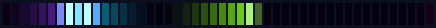
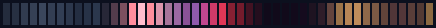
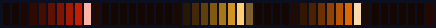
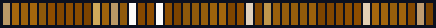
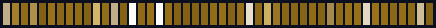
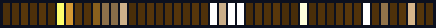
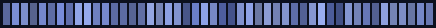

# House Lights themes

**106 built-in themes** for every occasion, 82 of them animated light by light, and
you can change any of them or make your own. Every picture on this page is drawn by the same
code that plays the theme on your house: 48 lights, one bar per light.

House Lights plays every light on its own, 15 times a second, so a comet can race the whole
roofline, snow can drift past the windows and fireworks can go off over the garage. Pick a theme
on the dashboard's **Quick Settings** tab, or put it on a schedule (sunset to 11 pm, say) and it
starts by itself.

**Make your own.** In the dashboard's **Themes** tab, open any theme below, change its colors,
speed and size and save it as yours, or build one from scratch from movements, layers and
sequences, with colors from a palette, one color or a photo. Yours work everywhere a built-in
theme does (Quick Settings, schedules) and can be exported as a file to share.
[How it works.](../README.md#themes)

**In season now:** **[Christmas](#christmas)** (19 themes), **[Thanksgiving](#thanksgiving)**
(12), and **[Animated-fast](#animated-fast)** (28): fast, showy motion for any
night. Most fast themes are in their holiday's group too.

Jump to: [Animated-fast](#animated-fast) · [Christmas](#christmas) · [Thanksgiving](#thanksgiving) · [USA](#usa) · [Celebration](#celebration) · [More US holidays](#more-us-holidays) · [Halloween](#halloween) · [School spirit](#school-spirit) · [Diwali](#diwali) · [Hindu festivals](#hindu-festivals) · [India](#india) · [Everyday](#everyday)

Good to know:

- Animated themes play light by light on **Govee H806A** (tested on real lights) and **WLED**
  controllers (tested with a simulator); other Govee permanent outdoor lights can try. On other
  kinds they show as a still picture or the theme's main color (see
  [Supported controllers](../README.md#supported-controllers)).
- Animated themes play while the dashboard is running; still themes stay on the lights.
- Fast means fast movement, not strobing: the beat themes pulse about twice a second, and no theme
  flashes the whole house more than 3 times a second (a test checks it).

## Animated-fast

Fast movement for any night: racing comets, marquee bulbs, color wipes, dance beats and fireworks. The fast holiday themes are here too.

28 themes.

| Theme | On 48 lights | What you see |
|---|---|---|
| **Rainbow rush** animated, fast |  | A double rainbow racing along the house with a shimmer. |
| **Neon racers** animated, fast |  | Neon pink, cyan, lime and yellow comets racing each other in both directions, each with a white-hot head and a long fading tail. |
| **Showtime marquee** animated, fast |  | Warm white theatre-marquee bulbs, every third one lit, running along the roofline. |
| **Color wipe** animated, fast |  | One bright color after another sweeps across the house behind a white edge, back and forth, once a second. |
| **Party beat** animated, fast |  | Neon colors jumping along the house on a 124-beats-a-minute dance beat. |
| **Bouncing comet** animated, fast |  | A bright bar shooting from one end of the house to the other and back, with a long tail and a new color at every bounce. |
| **Fireworks finale** animated, fast |  | The finale: firework bursts in every color going off all over the house, three a second. |
| **Anar fireworks** animated, fast |  | Firework bursts at random points: a white flash, then a gold, red, green, pink or blue ring racing outwards and fading, over a dim warm glow. |
| **Garba nights** animated, fast |  | Festive colors stepping along the house on a dandiya beat, flashing on each beat. |
| **Christmas marquee** animated, fast |  | Red, green and white marquee bulbs, every third one lit, running along the roofline. |
| **Reindeer dash** animated, fast |  | Red, green, gold and white comets dashing past each other in both directions over a dark night sky, each with a fading tail. |
| **Jingle beat** animated, fast |  | Red, green, gold and white jumping along the house on a lively beat. |
| **Peppermint twist** animated, fast |  | Red and white stripes, 4 lights each, spinning along the roofline like a barber pole. |
| **Wrapping paper wipe** animated, fast |  | Red, green, gold and white take turns sweeping across the house behind a bright edge, back and forth, once a second. |
| **Blizzard** animated, fast |  | A snowstorm: white flakes streaking along the roofline over deep icy blue. |
| **Christmas crackers** animated, fast |  | Red, green, gold and white bursts popping all over the house. |
| **Santa's sleigh** animated, fast |  | A bright golden streak racing across the house with a long sparkling trail, over a dark night sky. |
| **Turkey trot** animated, fast |  | Red, orange and gold comets racing along the house one after another, each with a fading tail. |
| **Harvest marquee** animated, fast |  | Orange, gold and red marquee bulbs, every third one lit, running along the roofline. |
| **Leaf storm** animated, fast |  | A gust of red, orange and gold leaves blowing along the house. |
| **Harvest hoedown** animated, fast |  | Autumn red, orange and gold jumping along the house on a barn-dance beat. |
| **Harvest fireworks** animated, fast |  | Orange, gold and red firework bursts all over the house. |
| **Autumn wipe** animated, fast |  | Red, orange, gold and rust take turns sweeping across the house behind a bright edge, back and forth. |
| **Red, white & blue fireworks** animated, fast |  | Red, white and blue firework bursts over a dark sky. |
| **Patriot racers** animated, fast |  | Red, white and blue comets racing past each other in both directions over a dark night sky, each with a fading tail. |
| **Liberty marquee** animated, fast |  | Red, white and blue marquee bulbs, every third one lit, running along the roofline. |
| **Star-spangled wipe** animated, fast |  | Red, white and blue take turns sweeping across the house behind a bright edge, back and forth, once a second. |
| **New Year's sparkle** animated, fast |  | Gold, white and silver firework sparkles bursting all over the house. |

## Christmas

19 themes.

| Theme | On 48 lights | What you see |
|---|---|---|
| **Christmas marquee** animated, fast |  | Red, green and white marquee bulbs, every third one lit, running along the roofline. |
| **Reindeer dash** animated, fast |  | Red, green, gold and white comets dashing past each other in both directions over a dark night sky, each with a fading tail. |
| **Jingle beat** animated, fast |  | Red, green, gold and white jumping along the house on a lively beat. |
| **Peppermint twist** animated, fast |  | Red and white stripes, 4 lights each, spinning along the roofline like a barber pole. |
| **Wrapping paper wipe** animated, fast |  | Red, green, gold and white take turns sweeping across the house behind a bright edge, back and forth, once a second. |
| **Blizzard** animated, fast |  | A snowstorm: white flakes streaking along the roofline over deep icy blue. |
| **Christmas crackers** animated, fast |  | Red, green, gold and white bursts popping all over the house. |
| **Northern lights** animated |  | Aurora greens, teals and purples slowly rippling along the house. |
| **Golden bells** animated |  | Rich gold with white glints twinkling across it. |
| **Retro C9 bulbs** still |  | Old-style big Christmas bulbs: red, green, blue, orange and yellow. |
| **Gingerbread house** still |  | Warm gingerbread brown-orange with white icing. |
| **Candy cane chase** animated |  | Red and white stripes, 3 lights each, marching along the roofline. |
| **Twinkling tree** animated |  | Evergreen green base with red, gold and white ornaments twinkling. |
| **Silent night** animated |  | Soft warm white with a slow, gentle twinkle. |
| **Snowfall** animated |  | White snowflakes drifting slowly along the roofline over icy blue. |
| **Santa's sleigh** animated, fast |  | A bright golden streak racing across the house with a long sparkling trail, over a dark night sky. |
| **Red & green chase** animated |  | Red and green bands chasing along the roofline. |
| **North Pole ice** animated |  | Icy blues with white shimmering across them. |
| **Cozy fireplace** animated |  | A slow fireplace glow: flames flickering from deep red to orange and yellow. |

## Thanksgiving

12 themes.

| Theme | On 48 lights | What you see |
|---|---|---|
| **Turkey trot** animated, fast |  | Red, orange and gold comets racing along the house one after another, each with a fading tail. |
| **Harvest marquee** animated, fast |  | Orange, gold and red marquee bulbs, every third one lit, running along the roofline. |
| **Leaf storm** animated, fast |  | A gust of red, orange and gold leaves blowing along the house. |
| **Harvest hoedown** animated, fast |  | Autumn red, orange and gold jumping along the house on a barn-dance beat. |
| **Harvest fireworks** animated, fast |  | Orange, gold and red firework bursts all over the house. |
| **Autumn wipe** animated, fast |  | Red, orange, gold and rust take turns sweeping across the house behind a bright edge, back and forth. |
| **Cozy fireplace** animated |  | A slow fireplace glow: flames flickering from deep red to orange and yellow. |
| **Pumpkin spice** animated |  | Pumpkin orange and rust with cream and gold twinkles. |
| **Maple wave** animated |  | Wide waves of maple red, orange, gold and rust rolling slowly along the house, blending into each other. |
| **Harvest glow** animated |  | Amber, gold, deep red and burnt orange slowly shimmering. |
| **Autumn leaves** animated |  | Red, orange and gold leaves drifting along the house. |
| **Cornucopia** still |  | Deep red, orange, gold and rust bands, 5 lights each. |

## USA

7 themes.

| Theme | On 48 lights | What you see |
|---|---|---|
| **Stars & stripes** still |  | The US flag: a blue field with white stars, then red and white stripes. |
| **Red, white & blue fireworks** animated, fast |  | Red, white and blue firework bursts over a dark sky. |
| **Patriot racers** animated, fast |  | Red, white and blue comets racing past each other in both directions over a dark night sky, each with a fading tail. |
| **Liberty marquee** animated, fast |  | Red, white and blue marquee bulbs, every third one lit, running along the roofline. |
| **Star-spangled wipe** animated, fast |  | Red, white and blue take turns sweeping across the house behind a bright edge, back and forth, once a second. |
| **Patriotic wave** animated |  | A blue field of twinkling stars, then red and white stripes, all rippling like a flag in the wind. |
| **Remembrance** still |  | Soft, steady red, white and blue for Memorial Day and Veterans Day. |

## Celebration

16 themes.

| Theme | On 48 lights | What you see |
|---|---|---|
| **Breathing color** animated pick your colors |  | One color slowly fading in and out, about every 4 seconds. |
| **Rainbow rush** animated, fast |  | A double rainbow racing along the house with a shimmer. |
| **Party beat** animated, fast |  | Neon colors jumping along the house on a 124-beats-a-minute dance beat. |
| **Fireworks finale** animated, fast |  | The finale: firework bursts in every color going off all over the house, three a second. |
| **Holi color splash** animated |  | Bright splashes of pink, green, yellow, blue, orange and purple bursting at random spots and spreading out. |
| **Tiranga wave** animated |  | Saffron, white and green thirds with a gentle waving-flag ripple. |
| **New Year's sparkle** animated, fast |  | Gold, white and silver firework sparkles bursting all over the house. |
| **Festival rainbow** animated |  | A full rainbow flowing slowly along the strip with a soft shimmer. |
| **Birthday confetti** animated |  | Party colors with bright confetti popping everywhere. |
| **Birthday candles** animated |  | One candle flame per year along the house over party colors; every 15 seconds they're blown out, confetti pops, and they relight. Set the age. |
| **18th birthday** animated |  | 18 candle flames over neon pink, purple and teal party colors. |
| **40th birthday** animated |  | 40 candle flames over black-and-gold party colors. |
| **50th birthday** animated |  | 50 candle flames over gold and silver. |
| **60th birthday** animated |  | 60 candle flames over diamond white and ice blue. |
| **Wedding red & gold** animated |  | Deep wedding red shimmering with gold and white. |
| **Graduation** animated |  | Gold with bright white sparkles. Change the colors to a school's. |

## More US holidays

4 themes.

| Theme | On 48 lights | What you see |
|---|---|---|
| **Valentine heartbeat** animated |  | Soft pink with a red lub-dub heartbeat pulse. |
| **Shamrock shimmer** animated |  | St. Patrick's greens with gold and white twinkles. |
| **Easter pastels** still |  | Pastel pink, yellow, mint, lavender and sky blue bands. |
| **New Year's sparkle** animated, fast |  | Gold, white and silver firework sparkles bursting all over the house. |

## Halloween

5 themes.

| Theme | On 48 lights | What you see |
|---|---|---|
| **Pumpkin patch** still |  | Pumpkin orange with purple, 5 lights each. |
| **Candy corn** still |  | Yellow, orange and white bands, like candy corn. |
| **Haunted flicker** animated |  | Orange lights that flicker, stutter and black out like failing bulbs. |
| **Witch's brew** animated |  | Purple and toxic green bubbling and swirling together. |
| **Lightning storm** animated |  | Dim stormy purple with sudden white lightning flashes. |

## School spirit

12 themes.

| Theme | On 48 lights | What you see |
|---|---|---|
| **UT Austin bands** still |  | Burnt orange and white bands. |
| **UT Austin game day** animated |  | Burnt orange and white chasing along the house with sparkles. |
| **Texas A&M bands** still |  | Maroon and white bands. |
| **Texas A&M game day** animated |  | Maroon and white chasing along the house with sparkles. |
| **UT Dallas bands** still |  | Orange and green bands. |
| **UT Dallas game day** animated |  | Orange, green and white chasing along the house with sparkles. |
| **Arizona State bands** still |  | Maroon and gold bands. |
| **Arizona State game day** animated |  | Maroon and gold chasing along the house with sparkles. |
| **Graduation** animated |  | Gold with bright white sparkles. Change the colors to a school's. |
| **Team bands (pick colors)** still pick your colors |  | Your team's colors in bands, 5 lights each. |
| **Team chase (pick colors)** animated pick your colors |  | Two team colors chasing along the house with sparkles. |
| **Team sparkle (pick colors)** animated pick your colors |  | A team color with white sparkles. |

## Diwali

12 themes.

| Theme | On 48 lights | What you see |
|---|---|---|
| **Warm gold** still |  | Warm gold on every light. |
| **Diya glow** animated |  | Warm amber diya flames: every light flickers independently like a candle, with slow golden flares drifting along the roofline. |
| **Rangoli chase** animated |  | Bands of magenta, orange, yellow, green, blue and purple, 5 lights each, chasing smoothly along the strip with soft blended edges. |
| **Anar fireworks** animated, fast |  | Firework bursts at random points: a white flash, then a gold, red, green, pink or blue ring racing outwards and fading, over a dim warm glow. |
| **Phuljhadi sparklers** animated |  | Dim warm gold background with bright white and gold sparks popping randomly all along the strip, like sparklers. |
| **Lakshmi gold wave** animated |  | Saffron-to-gold waves rolling along the house, with white glints sparkling on each wave crest. |
| **Flowing diyas** animated |  | Groups of 3 flickering orange and gold diyas floating on groups of 3 shimmering white water lights, the river flowing slowly along the roofline. |
| **Diwali river** animated |  | Wide bands of orange and white flowing along the roofline, blending into each other, the orange flickering like flames and the white shimmering like water. |
| **Akash kandil lanterns** animated |  | Glowing paper lanterns in orange, red, gold and pink, hanging along the roofline and gently swaying, over a dim warm glow. |
| **Diwali gold and amber** still |  | Gold and amber bands with orange-red and magenta accents, 5 lights each. |
| **Rangoli bands** still |  | Rangoli colors (magenta, orange, yellow, green, blue, purple) in bands of 5 lights. |
| **Toran garland** still |  | Marigold orange with mango-leaf green, like a toran over the door. |

## Hindu festivals

12 themes.

| Theme | On 48 lights | What you see |
|---|---|---|
| **Rangoli bands** still |  | Rangoli colors (magenta, orange, yellow, green, blue, purple) in bands of 5 lights. |
| **Toran garland** still |  | Marigold orange with mango-leaf green, like a toran over the door. |
| **Navratri nine colors** animated |  | The whole house steps through the nine Navratri colors, holding each for a few seconds with a soft cross-fade. |
| **Garba nights** animated, fast |  | Festive colors stepping along the house on a dandiya beat, flashing on each beat. |
| **Bonfire** animated |  | Flickering flames, dark red to orange and yellow, for Dussehra and Lohri. |
| **Holi color splash** animated |  | Bright splashes of pink, green, yellow, blue, orange and purple bursting at random spots and spreading out. |
| **Ganesh marigold** still |  | Marigold orange, yellow and red bands, 5 lights each. |
| **Janmashtami peacock** animated |  | Peacock-feather blues, teals, greens and purples, slowly blending along the house. |
| **Sankranti kites** animated |  | Colorful kites drifting across a dark blue sky at different speeds, swaying in the wind. |
| **Rakhi threads** animated |  | Red, gold and saffron twisting along like rakhi threads. |
| **Onam pookalam** still |  | Pookalam flower colors: yellow, orange, white and red bands. |
| **Shivratri glow** animated |  | Deep blue with a slow, soft white glow drifting through. |

## India

4 themes.

| Theme | On 48 lights | What you see |
|---|---|---|
| **Indian flag** still |  | Saffron, white and green, a third of the run each. |
| **Tiranga wave** animated |  | Saffron, white and green thirds with a gentle waving-flag ripple. |
| **Tricolor fireworks** animated |  | Saffron, white and green firework bursts over a dark sky. |
| **Chakra chase** animated |  | Saffron, white and green thirds, with a navy-blue chakra pulse moving through the white. |

## Everyday

9 themes.

| Theme | On 48 lights | What you see |
|---|---|---|
| **Warm gold** still |  | Warm gold on every light. |
| **Candlelight** animated |  | Warm white candlelight with a barely-there flicker. |
| **Moonlight** animated |  | Cool soft moonlight, slowly shifting. |
| **Breathing color** animated pick your colors |  | One color slowly fading in and out, about every 4 seconds. |
| **Solid color** still pick your colors |  | One color of your choice on every light. |
| **Alternating** still pick your colors |  | Two or more colors of your choice taking turns, 5 lights each. |
| **Gradient** still pick your colors |  | One color blending into another from end to end. |
| **Random from palette** still pick your colors |  | Colors from your list in a shuffled order, 5 lights each. |
| **Silent night** animated |  | Soft warm white with a slow, gentle twinkle. |

---

This page is made by `tools/make_theme_gallery.py`; run it again after adding a theme.
